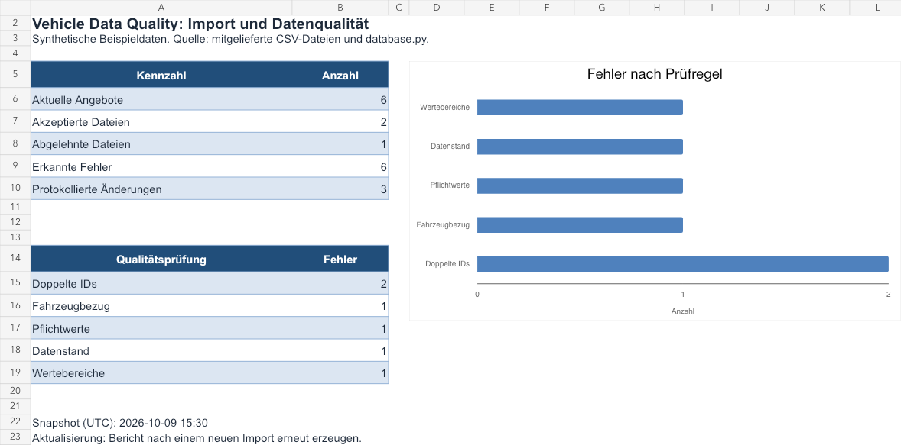
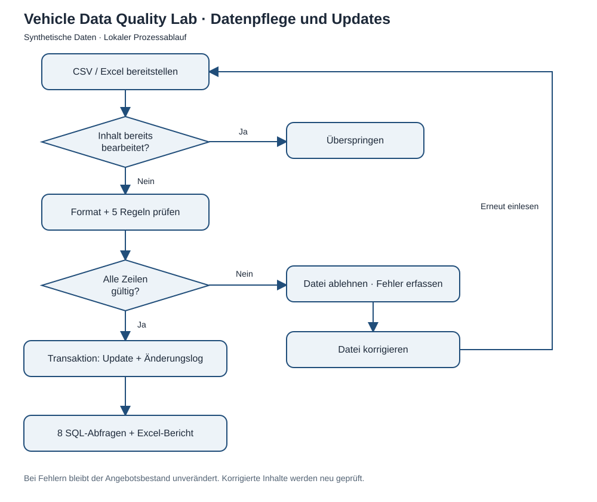
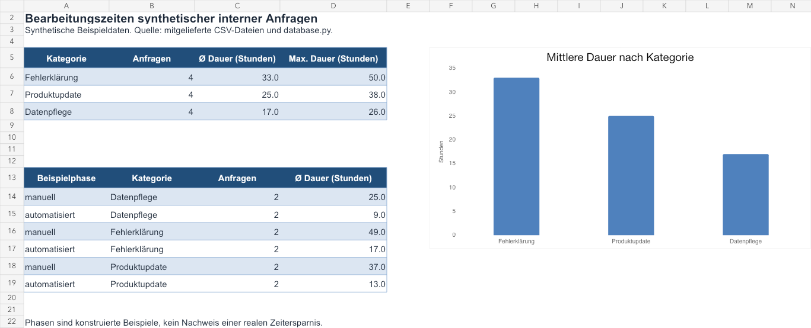

# Vehicle Data Quality Lab

**CSV- und Excel-Updates prüfen, Fahrzeugangebote sicher aktualisieren und Änderungen mit SQL und Excel auswerten.**

Ein kleines, ausführbares Portfolio-Projekt von Ibrahim Abdullah. Es bildet typische Aufgaben in der Datenpflege nach: wiederkehrende Imports, Qualitätskontrollen, Fehleranalyse, Dokumentation und verständliche Berichte. Alle Marken, Angebote und internen Anfragen sind synthetisch. Das Projekt ist unabhängig von Unternehmen und verwendet keine Kunden- oder Unternehmensdaten.

**Kleine Erweiterung:** [KI-gestützte Fehleranalyse](docs/ai-review.md) mit fünf Fällen, einem 91-zeiligen Python-Helfer und einem [BPMN-Prozessmodell](docs/vehicle-data-review.bpmn). Der manuelle Workflow funktioniert ohne API-Schlüssel.



## In zwei Minuten ausprobieren

Voraussetzung: Python 3.10 oder neuer. Keine externe Datenbank und kein Excel-Programm erforderlich.

```bash
python3 -m venv .venv
source .venv/bin/activate
# Windows: .venv\Scripts\activate
python -m pip install -r requirements.txt
python -m vehicle_data_quality demo
python -m unittest discover -s tests -v
```

Für die zusätzlichen Gherkin-Abnahmetests und JUnit-Berichte:

```bash
python -m pip install -r requirements-dev.txt
python -m xmlrunner discover -s tests -o reports/unit -v
python -m behave --junit --junit-directory reports/acceptance
```

Die [Testdokumentation](docs/testing.md) beschreibt die Szenarien, Grenzwerte und den Jenkins-Lauf.

Die Demo legt `demo-output/` an. Das Ziel muss leer sein; für weitere Läufe ein neues Ziel wählen:

```bash
python -m vehicle_data_quality demo --output demo-output/zweiter-lauf
```

Ergebnisse: `report.xlsx` mit sechs Arbeitsblättern und zwei Diagrammen, acht SQL-Auswertungen als CSV, `results.json`, SQLite-Datenbank und die verarbeiteten Beispieldateien. Ein fertiger [Excel-Beispielbericht](docs/example-report.xlsx) ist im Repository enthalten.

### Was die Demo nachweist

| Schritt | Erwartetes Ergebnis |
| --- | --- |
| Fehlerhafte CSV mit sechs Datenzeilen | Datei abgelehnt, sechs Fehler in fünf Regelgruppen, kein Angebotsupdate |
| Korrigierte CSV mit vier Datenzeilen | Zwei neue Angebote, ein Update, ein unverändertes Angebot |
| Dieselben Daten als XLSX | Vier unveränderte Angebote, kein zusätzlicher Änderungseintrag |
| Erneuter Import derselben CSV | Über SHA-256 erkannt und übersprungen |
| Bestand nach der Demo | Sechs Angebote, drei protokollierte Änderungen, zwei akzeptierte und eine abgelehnte Datei |

## Fachlicher Ablauf



Der [editierbare Ablaufplan](docs/process.drawio) lässt sich in Draw.io öffnen. Es ist ein einfacher Prozessablauf, kein vollständiges BPMN-Modell. Drei [User Stories mit Abnahmekriterien](docs/user-stories.md) verbinden die Implementierung mit den Anforderungen.

Die Erweiterung enthält zusätzlich ein [BPMN-2.0-Modell](docs/vehicle-data-review.bpmn) mit Service Tasks, User Tasks, exklusiven Entscheidungen und Korrekturschleife. Der [BPMN-Überblick](docs/bpmn-review.svg) zeigt auch die manuelle KI-Prüfung im Fehlerpfad. Das Modell beschreibt den fachlichen Ablauf und ist nicht als ausführbarer Workflow konfiguriert.

1. Eine Fachabteilung stellt eine CSV- oder XLSX-Datei bereit.
2. Die Anwendung liest eine Momentaufnahme der Datei und erkennt bereits bearbeitete Inhalte.
3. Sie prüft Format und Fachregeln. Fehler werden je Import und Zeile dokumentiert.
4. Nur eine vollständig gültige Datei aktualisiert die Angebote. Alle Updates und der Änderungsnachweis laufen in einer gemeinsamen Transaktion.
5. SQL-Abfragen und der Excel-Bericht zeigen Bestand, Fehler und Änderungen. Nach der Korrektur wird die geänderte Datei erneut eingelesen.

## Fünf Qualitätsprüfungen

| Regel | Prüfung |
| --- | --- |
| `REQUIRED` | Alle sieben Pflichtfelder sind befüllt. |
| `DUPLICATE` | Jede Angebots-ID kommt innerhalb einer Datei höchstens einmal vor. |
| `FOREIGN_KEY` | Das referenzierte Fahrzeug existiert in den Stammdaten. |
| `VALUE` | Positive Monatsrate mit höchstens zwei Nachkommastellen; gültiges Produkt, Datum, ID und ganzzahlige Laufzeit/Fahrleistung innerhalb der Grenzen. |
| `STALE_UPDATE` | Geänderte Angebote benötigen einen neueren Datenstand als der vorhandene Datensatz. |

Beschädigte Dateien, falsche Spalten und Formeln in XLSX-Dateien werden zusätzlich als `FILE_SCHEMA` erfasst. Ein einziger Fehler lehnt die **gesamte Datei** ab. Bereits vorhandene identische Angebote werden nicht erneut geschrieben.

## Eingabeformat

CSV: UTF-8, Komma als Trennzeichen, Punkt als Dezimalzeichen. XLSX: erste aktive Tabelle, erste Zeile als Kopfzeile, keine Formeln. Die Spaltenreihenfolge ist beliebig, die sieben Spalten müssen genau vorhanden sein.

```csv
offer_id,vehicle_id,product,price_eur,term_months,annual_mileage,updated_at
OFF005,V003,Leasing,269.90,36,10000,2026-10-01
```

| Feld | Bedeutung / Grenzen |
| --- | --- |
| `offer_id` | 1–40 Großbuchstaben, Ziffern, `_` oder `-` |
| `vehicle_id` | Bekannte ID aus `vehicles`; Demo: `V001` bis `V004` |
| `product` | `Leasing` oder `Finanzierung` |
| `price_eur` | Monatliche Beispielrate: größer 0, höchstens 10.000.000 EUR, maximal zwei Nachkommastellen |
| `term_months` | Ganze Zahl zwischen 1 und 120 |
| `annual_mileage` | Ganze Zahl zwischen 1 und 200.000 km |
| `updated_at` | ISO-Datum, z. B. `2026-10-01` |

Preise werden mit `Decimal` geprüft und als ganze Centbeträge gespeichert. Die Raten sind vorgegebene Beispieldaten; das Programm berechnet keine Finanzierungsangebote. Ein unverändertes Angebot darf denselben Datenstand behalten. Jede Änderung, auch eine reine Datumsänderung, muss einen neueren Datenstand besitzen. Datum und Dateihash dienen unterschiedlichen Zwecken: Versionsprüfung je Angebot und Wiederholungsschutz je Datei.

## Einzelschritte und Überwachung

```bash
# Stammdaten und synthetischen Startbestand anlegen (wiederholbar)
python -m vehicle_data_quality init

# Einen gültigen Import verarbeiten
python -m vehicle_data_quality import data/02_valid_updates.csv

# Absichtlich fehlerhafter Import: Exit-Code 2, Bestand bleibt erhalten
python -m vehicle_data_quality import data/01_invalid_updates.csv

# Alle CSV-/XLSX-Dateien eines vorhandenen Ordners einmal prüfen
python -m vehicle_data_quality scan demo-output/inbox

# Ordner alle fünf Sekunden prüfen; mit Strg+C beenden
python -m vehicle_data_quality watch demo-output/inbox --interval 5

# Berichte aus dem aktuellen Datenbankbestand erzeugen
python -m vehicle_data_quality report --output reports/report.xlsx
python -m vehicle_data_quality queries --output reports/sql-results

# Eigene Datenbank verwenden: globale Option vor dem Unterbefehl
python -m vehicle_data_quality --db state/weitere-demo.sqlite init
```

`init` muss vor dem ersten Import ausgeführt werden. Die Demo verwendet ihre eigene Datenbank in `demo-output/`; mit `--db demo-output/vehicle_data_quality.sqlite` kann dieser Bestand weiterverwendet werden.

Die Überwachung schreibt JSON-Ereignisse nach stdout. Ungültige Dateien stoppen die Verarbeitung weiterer Dateien nicht. Identische Inhalte werden auch unter einem anderen Dateinamen übersprungen. Eine korrigierte Datei hat einen neuen Hash und wird erneut geprüft. Fehlerhafte Dateien werden nicht verschoben oder gelöscht. Quelldateien erst unter einem temporären Namen schreiben und nach Abschluss in den Eingangsordner umbenennen, damit der Monitor keine halbfertigen Dateien liest.

Beim Einzelimport bedeuten Exit-Code `0` Erfolg/bereits erfolgreicher Import, `2` fachlich abgelehnte Datei und `1` einen Betriebsfehler. `scan` und `watch` melden Ergebnisse je Datei als JSON; fachliche Ablehnungen beenden den Monitor nicht. Datei-Lesefehler erscheinen als `error`-Ereignis, ohne Importdatensatz. Nicht lesbare Dateien können wiederholt gemeldet werden. Datenbank- oder Ordnerfehler beenden den Prozess mit Exit-Code `1`.

## Acht SQL-Auswertungen

| Datei | Fragestellung |
| --- | --- |
| [01_current_offers.sql](sql/01_current_offers.sql) | Welche Angebote gelten aktuell? Join über Angebote, Fahrzeuge und Marken. |
| [02_offers_by_brand.sql](sql/02_offers_by_brand.sql) | Wie verteilen sich Anzahl und durchschnittliche Rate auf Marken? |
| [03_import_summary.sql](sql/03_import_summary.sql) | Welche Dateien wurden akzeptiert, abgelehnt oder ohne Änderungen verarbeitet? |
| [04_errors_by_rule.sql](sql/04_errors_by_rule.sql) | Welche Qualitätsregeln schlagen wie oft an? |
| [05_change_history.sql](sql/05_change_history.sql) | Was wurde wann verändert, mit welchem alten und neuen Preis? |
| [06_price_changes.sql](sql/06_price_changes.sql) | Welche Preisänderungen ergeben sich in EUR? |
| [07_service_by_category.sql](sql/07_service_by_category.sql) | Welche synthetischen Anfragearten haben die längsten Bearbeitungszeiten? |
| [08_service_by_phase.sql](sql/08_service_by_phase.sql) | Wie lassen sich konstruierte manuelle und automatisierte Beispielphasen vergleichen? |

Die zwölf internen Anfragen wurden ausdrücklich mit unterschiedlichen Laufzeiten erzeugt. Daraus lässt sich **keine reale Zeitersparnis oder kausale Wirkung** ableiten. Sie demonstrieren Aggregation und eine verständliche Darstellung der Ergebnisse.



## Excel-Bericht

`openpyxl` erzeugt die Blätter **Übersicht, Angebote, Importe, Änderungen, Fehler und Serviceanalyse**. Tabellen sind filterbar, Spaltenüberschriften fixiert und Preise/Datumswerte typisiert. Die Übersicht zeigt Importkennzahlen und Fehler nach Regel; die Serviceanalyse zeigt durchschnittliche Anfragezeiten. Der Bericht ist eine Momentaufnahme und wird nach neuen Imports erneut erzeugt. Berechnungen erfolgen in SQL/Python; es gibt keine Excel-Formeln oder Makros. Text aus Quelldaten wird in XLSX als Text geschrieben, CSV-Ausgaben schützen vor Formelausführung beim Öffnen.

## Aufbau und Tests

```text
vehicle_data_quality/       Import, Regeln, SQLite-Schema, Bericht und Kommandozeile
data/           Absichtlich fehlerhafte und korrigierte Beispiel-Updates
examples/       Wiederholbare KI-Beispielantwort und exportierter Prompt
sql/            Acht separat lesbare SQL-Abfragen
docs/           User Stories, Draw.io-Datei, Vorschauen und Beispielbericht
tests/          Automatisierte Integrations- und Regressionstests
features/       Gherkin-Abnahmetests mit Python-Schritten (Behave)
Jenkinsfile     Regression, Abnahme und Demo mit JUnit-Berichten
.github/        CI für Python 3.10 und 3.13
```

Drei fachliche Tabellen (`brands`, `vehicles`, `offers`) werden um Importprotokoll, Rohzeilen, Fehler, Änderungsverlauf und synthetische Serviceanfragen ergänzt. Fremdschlüssel sind aktiv. Die Tests prüfen unter anderem vollständige Ablehnung fehlerhafter Dateien, Wiederholung nach Korrektur, gleichzeitige identische Imports, Versionskonflikte, defekte XLSX-Dateien, genaue Centbeträge, SQL-Ergebnisse und Inhalte des Excel-Berichts.

GitHub Actions führt Regressionstests, Gherkin-Szenarien und die Demo aus. JUnit-XML und Demoberichte werden pro Python-Version als Artefakt gespeichert. Der `Jenkinsfile` führt dieselben Prüfungen aus und veröffentlicht die XML-Ergebnisse über das JUnit-Plugin. Die Produktionsabhängigkeiten bleiben in `requirements.txt`; Testwerkzeuge stehen separat in `requirements-dev.txt`.

## Bewusster Umfang

Lokales Lernprojekt mit SQLite und Ordnerüberwachung, ohne Weboberfläche, RPA-Plattform oder reale Systemanbindung. Die KI-Erweiterung exportiert einen Prompt für eine manuelle Unterhaltung und prüft eine gespeicherte Antwort; es gibt keine direkte API-Anbindung. Pro Datei höchstens 5 MiB und 10.000 Datenzeilen; XLSX-Dateien nur aus vertrauenswürdigen lokalen Quellen verwenden, da das Limit die komprimierte Datei betrifft. Die Stammdaten sind vorgegeben; Änderungen an Marken und Fahrzeugen werden nicht importiert. Für eine produktive Lösung wären unter anderem Zugriffsschutz, zentrale Überwachung, sichere Dateiablage, Datenaufbewahrung und ein fachlicher Freigabeprozess zu ergänzen.

## Lizenz

MIT — siehe [LICENSE](LICENSE).
