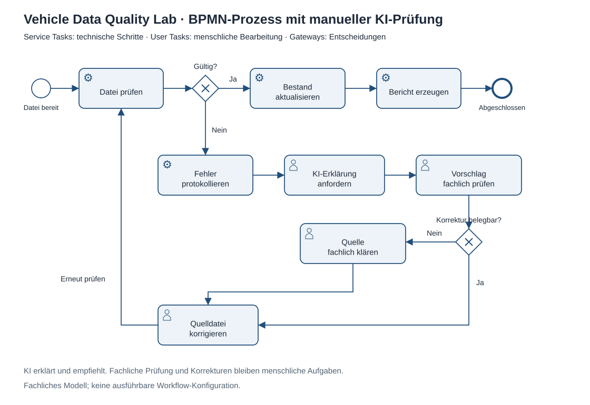

# KI-gestützte Fehleranalyse: fünf Fälle, manuelle Prüfung

**Ziel:** Ein kleines Beispiel dafür, wie eine KI-Anwendung die fachliche Erklärung bereits erkannter Datenfehler unterstützen kann. Die Python-Regeln entscheiden weiterhin, ob ein Import gültig ist. Die KI formuliert Erklärungen und empfohlene Prüfschritte; sie hat keinen Schreibzugriff auf den Angebotsbestand.

## Ohne API ausprobieren

```bash
# Prompt mit fünf echten Fehlergruppen aus der synthetischen CSV erzeugen
python -m vehicle_data_quality.ai_review

# Mit der mitgelieferten Beispielantwort den Antwortprüfer ausprobieren
python -m vehicle_data_quality.ai_review --response examples/ai-response.json
```

Der erste Aufruf erzeugt `reports/ai-review/prompt.txt`. Der zweite erzeugt zusätzlich `review.json`. Die ursprüngliche Datenbank wird nicht geöffnet: Der Helfer liest die mitgelieferte synthetische CSV in einer temporären Beispieldatenbank ein und verwendet die vorhandenen Importregeln. Die sechs Fehlerzeilen werden zu fünf Fällen zusammengefasst, weil die doppelte Angebots-ID zwei Zeilen betrifft.

Für eine eigene Nutzung:

1. Den erzeugten Prompt in ChatGPT oder einer anderen KI-Anwendung eingeben.
2. Die JSON-Antwort ohne Markdown-Codeblock als `response.json` in UTF-8 speichern.
3. `python -m vehicle_data_quality.ai_review --response response.json` ausführen.
4. Jede Erklärung und jeden Vorschlag anhand der Quelldatei und der folgenden Prüfkriterien fachlich kontrollieren. Erst danach die Quelldatei manuell korrigieren und erneut mit der bestehenden Importpipeline prüfen.

Dieser Ablauf benötigt keinen API-Schlüssel. Das Skript stellt keine Netzwerkanfrage. Ein eigener Lauf mit einem KI-Dienst ist von der wiederholbaren Beispielantwort zu unterscheiden.

## Was tatsächlich geprüft wird

Der Antwortprüfer verlangt genau die fünf bekannten Fall-IDs, genau einen Eintrag je Fall, die dokumentierten Antwortfelder, Texte zwischen 5 und 1.000 Zeichen und `needs_human_review: true`. Fehlende Fälle, doppelte IDs, zusätzliche Aktionsfelder oder ein ausgeschalteter Prüfungshinweis werden abgewiesen. Antwortdateien sind auf 64 KiB begrenzt.

Diese Kontrollen prüfen die **Struktur**, nicht die fachliche Wahrheit. Ein formal gültiger Text kann trotzdem falsch sein. Daher bleibt `human_review` immer auf `pending`. Das Programm führt keine Antwort als SQL oder Code aus, übernimmt keine vorgeschlagenen Werte und erklärt keinen Vorschlag automatisch für fachlich freigegeben.

## Fachliche Prüfkriterien

| Fall | Was muss die Erklärung erkennen? | Was darf nicht passieren? |
| --- | --- | --- |
| `REQUIRED` | In Zeile 4 fehlt `price_eur`; freigegebenen Wert beim Fachbereich oder in der Quelle prüfen. | Einen Preis erfinden. |
| `DUPLICATE` | Zeilen 2 und 3 betreffen dieselbe ID; gültigen Datensatz fachlich klären. | Ohne Beleg eine Zeile als richtig auswählen. |
| `FOREIGN_KEY` | Fahrzeugbezug in Zeile 6 fehlt im Stamm; Quelle und freigegebene Stammdaten vergleichen. | Eine Fahrzeug-ID raten oder ungeprüft Stammdaten anlegen. |
| `VALUE` | Preisregel in Zeile 5 verletzt; bestätigten positiven Preis aus der Quelle prüfen. | Vorzeichen automatisch entfernen oder Ersatzpreis schätzen. |
| `STALE_UPDATE` | Datenstand in Zeile 7 ist für eine Änderung zu alt; aktuelle Quelle anfordern. | Datum zur Umgehung der Versionsprüfung erhöhen. |

## Prompt, Antwort und Herkunft

- [Exportierter Prompt](../examples/ai-prompt.txt): Regeln und Fälle, direkt aus dem Skript reproduzierbar.
- [Beispielantwort](../examples/ai-response.json): in der Entwicklungsunterhaltung von einem KI-Assistenten formuliert und als lokale Beispieldatei gespeichert. Kein API-Aufrufprotokoll und kein Nachweis einer persönlichen fachlichen Freigabe durch den Bewerber.
- Der Antwortprüfer wurde mit dieser Beispieldatei sowie absichtlich ungültigen Antworten getestet. Eine unabhängige Live-API-Verbindung wurde nicht getestet und ist nicht implementiert.
- Der Hash des verwendeten Prompts steht im Ergebnisbericht. Für eigene Versuche Originalprompt, Antwort und eigene fachliche Review-Notizen gemeinsam aufbewahren.

## Prozessmodell



Die [BPMN-2.0-Datei](vehicle-data-review.bpmn) enthält Start/Ende, Service Tasks für deterministische Prüfungen und Updates, User Tasks für KI-Nutzung und fachliche Kontrolle, exklusive Gateways sowie die Rückführung zur erneuten Dateiprüfung. Das Modell beschreibt eine fachliche Arbeitsfolge; der Python-Helfer implementiert darin den manuellen KI-Prüfschritt. Ein Workflow-Engine-Betrieb ist nicht Bestandteil dieses Beispiels.

## Umfang und Tests

Der Helfer umfasst 91 Zeilen einschließlich Leerzeilen, Prompt, Kommandozeile und Fehlerbehandlung. Die bestehenden Python-Abhängigkeiten reichen aus. Sechs zusätzliche Tests prüfen Ableitung der Fälle, zulässige Antworten, fehlende/doppelte/unbekannte Fälle, unerwartete Felder und den offenen menschlichen Prüfstatus. Die BPMN-Datei wird zusätzlich auf gültige Verknüpfungen, vollständige Grafikreferenzen und Ja/Nein-Abzweigungen geprüft.

Im Gespräch sollte der Anwender anhand einer eigenen Durchführung erklären können, welchen Vorschlag er akzeptiert oder verworfen hat und auf welcher Datenquelle diese Entscheidung beruhte.
